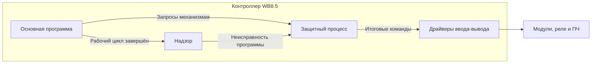

# Источники решений — 14.11.2026

Текстовые сообщения пользователя и ассистента из первичного журнала этого чата за 14.11.2026 по Europe/Moscow, начиная с открытия рабочей сессии и заканчивая поручением сохранить контрольную точку. 74 сообщения, включая промежуточные ответы и пояснения. Это архив обсуждения: предложение или промежуточное «принимаем» не заменяет позднейшего решения.
Извлечение: только текст сообщений user/assistant; системные сообщения, окружение и выводы инструментов не включены. Из ответов ассистента удалены служебные блоки ссылок на память; локальные ссылки на файлы проекта приведены к относительным и без номеров строк для переноса на другой компьютер. Убраны пробелы в конце строк; остальной текст сообщений сохранён; даты исходных записей преобразованы из UTC в МСК. Технические комментарии ассистента включены для последовательности, но сами не являются решениями пользователя.
Окончательные решения, отменённые варианты и области применения: [итоги сессии](2026-11-14_Итоги_сессии.md).

## S01 — Пользователь — 14.11.2026, 15:17:15 МСК

Начинаем новую рабочую сессию по теплообменнику в этом существующем чате. SSD подключён. Проверь фактический компьютер, папку P:\Projects\Теплообменник, инструкции проекта, Git: ветку, HEAD, рабочее дерево и staging. Последняя известная сохранённая точка: ffcd4e5ab09a413de1fc74b50aaba6bb47192ec3 от 13.11.2026, решения D-298–D-321, переход на Wiren Board 8.5. Проверь актуальность по файлам и удалённой ветке; старое origin/main не выдавай за свежую проверку GitHub. Не выполняй pull, merge, reset, commit или push и не перезаписывай незакоммиченные изменения. Прочитай PROJECT_CONTEXT.md, DECISIONS.md, INTEGRATION_INTERFACE.md и последние итоги сессии. Восстанови контекст без переутверждения решений и начни с согласованной точки продолжения: общей таблицы состояний и приоритетов. Сначала покажи краткий статус готовности, затем собери таблицу из уже утверждённых решений со ссылками на них, выдели реальные пробелы и задай один первый вопрос. Новые требования и аварийные алгоритмы не утверждай самостоятельно; не раздувай обсуждение гипотетическими сценариями без обоснования, но существенные вопросы безопасности сохрани. Пока работаем с документацией и обсуждением, без управления реальным оборудованием.

## S02 — Ассистент — 14.11.2026, 15:17:40 МСК

Проверю компьютер, папку на SSD и локальный Git, затем отдельно прочитаю текущий хеш ветки на GitHub. После сверки документов соберу таблицу состояний и приоритетов из утверждённых решений и выделю первый вопрос для обсуждения. Файлы и оборудование не изменяю.

## S03 — Ассистент — 14.11.2026, 15:19:09 МСК

Проверка выполнена на компьютере `RMLAPTOP`. Том `P:` (`AI_Projects`, NTFS) и проект доступны. Ветка `main`, HEAD — `ffcd4e5…`; рабочее дерево и staging чистые. Прямой запрос GitHub сейчас вернул тот же полный хеш — это свежая проверка удалённой ветки.

Контекст WB восстановлен. Утверждённые алгоритмы позволяют начать разработку и проверку на имитаторе, но рабочая реализация и допуск установки к пуску ещё не завершены. Сейчас сверяю переходы и приоритеты, чтобы таблица не смешивала основные состояния ТО с охлаждением, инженерным режимом и аварийными признаками.

## S04 — Ассистент — 14.11.2026, 15:22:08 МСК

**Контекст актуален. Можно переходить к структуре программы WB и проверке алгоритмов на имитаторе; готовность установки к физическому пуску пока не подтверждена.**

Проверено сейчас:

- Компьютер — **RMLAPTOP**, Windows; том `P:` — `AI_Projects`, NTFS, доступен.
- Корень репозитория — `P:\Projects\Теплообменник`, ветка **main**.
- HEAD — **`ffcd4e5ab09a413de1fc74b50aaba6bb47192ec3`**, 13.11.2026, 15:33:43 МСК.
- Рабочее дерево чистое, staging пуст.
- **Прямой запрос GitHub** вернул тот же хеш `main`; расхождений нет. Это не вывод из сохранённого `origin/main`.
- Файлы не изменял; pull, merge, reset, commit и push не выполнял.

Прочитаны инструкции, актуальные контекст, реестр, интерфейс и итоги. Переход на **WB8.5**, веб-HMI и D-298–D-321 сохраняются без переутверждения.

**Сводная таблица состояний и переходов**

Основных состояний ТО четыре. Авария передаётся отдельно; ручной режим, охлаждение и инженерные проверки не создают дополнительных основных состояний. Основание — [D-301](2026-11-13_Итоги_сессии.md).

| Состояние или ситуация | Уже утверждённое поведение и переход | Основание |
|---|---|---|
| **Остановлен** | Новая допустимая команда запуска переводит в «Запуск». Пуск ARANGA — по фронту 0→1, без очереди. Ручной режим запрещает дистанционный пуск, но допускает местный при остальных разрешениях. | [D-298–D-303](2026-11-13_Итоги_сессии.md) |
| **Запуск** | Выполняется подготовка оборудования; дымосос с включения получает Fmin. Режим зафиксирован. «В работе» — после успешной подготовки и подтверждения оператором закрытия ШБ. | [D-295–D-297](2026-11-11_Итоги_сессии.md) |
| **В работе — ручной режим** | Частоту задаёт оператор. Задания ARANGA принимаются, но ручное управление не вытесняют. Получение задания само режим не меняет. | [D-303–D-304](2026-11-13_Итоги_сессии.md) |
| **В работе — ARANGA** | Внешнее задание проходит LIMIT и коррекцию резонанса. При потере обмена действует аварийная частота; возврат последнего задания — по первой успешной операции при отсутствии старшего местного приоритета. | [D-304](2026-11-13_Итоги_сессии.md) |
| **Останов — до закрытия ШТ** | Принятый Стоп HMI/ARANGA обязателен. Запрашивается открытие ШБ; после подтверждения закрывается ШТ. Уже работающий дымосос сразу получает частоту охлаждения, по умолчанию 25 Гц. Разрешённая циркуляция сохраняется. | [D-262–D-264](2026-11-10_Итоги_сессии.md), [D-163](2026-11-02_Итоги_сессии.md) |
| **Останов — после закрытия ШТ** | Закрывается затвор рабочего насоса. Насос выключается по подтверждению закрытия либо через 45 с; неисправность сохраняется. Затем затворы получают положения останова, по умолчанию оба открыты. После завершения процедуры — «Остановлен». | [D-169](2026-11-05_Итоги_сессии.md) |
| **Остановлен — самостоятельное охлаждение** | Дымосос может работать по температурному запросу при разрешениях и отсутствии блокировок. Потеря подтверждения закрытия ШТ вводит требования к циркуляции; насосы только ради этого автоматически не запускаются. | [D-019](04_Алгоритмы.md), [D-163](2026-11-02_Итоги_сессии.md) |
| **Остановлен — инженерные проверки** | Готовность к пуску = 0, причина «Инженерный режим». Общий цикл: ветвь №1 → №2 → ШТ → ШОД → дымосос. Переходы — по подтверждению инженера и допускам конкретного теста. | [D-265](2026-11-10_Итоги_сессии.md), [D-301](2026-11-13_Итоги_сессии.md) |
| **Зависание основной программы работающего ТО** | После 2 с без завершённого цикла — критическая авария и обязательный останов. Исправный защитный процесс ведёт насосы, ШТ, ШОД и дымосос. Восстановление основной программы останов не отменяет. | [D-312–D-319](2026-11-13_Итоги_сессии.md) |
| **Полный отказ WB / отсутствие обмена** | При работе через ТО ARANGA через 5 с сама инициирует байпас и требование открыть ШБ. Аппаратное обеспечение насосов — ваша отдельная задача; конкретное исполнение не подтверждено. | [D-320–D-321](2026-11-13_Итоги_сессии.md) |

Это сводный уровень. Внутренние этапы насосных переключений, проверок и диагностики сохраняют собственные согласованные условия.

**Утверждённые приоритеты**

| Область | Что имеет приоритет |
|---|---|
| Команды | **Стоп выше Пуска**. Повторный Стоп не сбрасывает таймеры; новый Пуск не отменяет обязательный останов. [D-299](2026-11-13_Итоги_сессии.md) |
| Насосы | Самостоятельные отключающие защиты выше требования сохранять циркуляцию до закрытия ШТ. [D-314](2026-11-13_Итоги_сессии.md) |
| ШТ | Запрет движения/питания не обходится требованием закрыть ШТ. Действует предусмотренная процедура неисправности и ручного закрытия. [D-315](2026-11-13_Итоги_сессии.md) |
| Дымосос | Задание принятого штатного останова или останова при зависании выше ручной/внешней частоты. Запреты работы ПЧ сохраняются. [D-262](2026-11-10_Итоги_сессии.md), [D-316](2026-11-13_Итоги_сессии.md) |
| ШОД при зависании | Удержание при аварии сети — высшее; далее действующие температурные/аварийные воздействия; только при их отсутствии применяется **30%**. [D-317](2026-11-13_Итоги_сессии.md) |
| Основная программа / защита | Восстановившаяся основная программа не отменяет защитный останов и не выдаёт конкурирующие команды. Авария управления снимается отдельным инженерным сбросом. [D-315–D-319](2026-11-13_Итоги_сессии.md) |

**Реальные пробелы**

1. **До реализации соответствующих блоков:** механизм единственного владельца выходов; критерий доступности веб-HMI; состояния I/O при загрузке/отказе; реализация NV. Реакции надзора вне согласованного случая «ТО работает» ещё не полностью сведены.
2. **Стык двух утверждённых решений:** D-304 допускает возврат частоты после восстановления обмена, а D-320 уже запускает байпас на стороне печи. Нужно определить согласованное продолжение, не отменяя начатый останов. Это пробел взаимодействия, а не доказанное противоречие самих требований.
3. **Для подключения и эксплуатации:** карты каналов/Modbus, достоверность данных и электрическая совместимость. Проверки аппаратного обеспечения при отказе WB и тепловой безопасности остаются обязательными; согласованные таймеры не доказывают безопасное время без циркуляции.

**Первым предлагаю определить владельца физических команд.** Это позволит реализовать уже согласованный приоритет защитного процесса. Реальный случай — основная программа возобновилась после зависания и пытается выдать прежнюю команду, пока защитный процесс завершает останов.

Предлагаемый вариант: основная программа формирует запросы, а защитный процесс проверяет разрешения и единолично выдаёт итоговые команды механизмам. Это пока предложение по организации программы.

**Принимаем, что физические команды выдаёт только защитный процесс, а основная программа не записывает выходы напрямую?**

## S05 — Пользователь — 14.11.2026, 17:51:17 МСК

перед Ответом я прошу тебя рассказать, что такое защитный процесс, чем он отличается от рабочей команды, где исполняется тот и другой и как между собой взаимодействует.

## S06 — Ассистент — 14.11.2026, 17:51:38 МСК

Объясню, что мы называем защитным процессом, и покажу взаимодействие на примере насоса. Отдельно отмечу, что уже согласовано, а что пока предложено для реализации на WB.

## S07 — Ассистент — 14.11.2026, 17:52:58 МСК

Под **защитным процессом** мы понимаем отдельную службу нашей будущей программы на WB, которая выполняет согласованные защитные действия независимо от основной программы. Это ещё предстоит написать и проверить; готовой функции «защита теплообменника» в контроллере нет.

Уточню термин: **рабочая команда и основная программа — разные вещи**. Команда — конкретное указание, например «включить насос №1». Основная программа решает, когда такое указание требуется.

| Часть системы | Что делает | Где исполняется |
|---|---|---|
| **Основная программа ТО** | Ведёт запуск, работу, штатный останов, смену насосов, инженерные процедуры. Рассчитывает требуемые команды механизмам. | На WB8.5 |
| **Надзор программы** | Проверяет, завершается ли рабочий цикл основной программы. По принятому решению отсутствие завершения 2 с означает неисправность управления. | Отдельно от основной программы, на том же WB |
| **Защитный процесс** | Проверяет действующие защитные условия и выполняет согласованный аварийный останов при зависании основной программы. | На том же WB, отдельно от основной программы |
| **Драйверы ввода-вывода** | Получают сигналы модулей и передают им команды: переключить реле, изменить аналоговый выход, отправить команду ПЧ. | На WB; сами модули физически подключены к нему |
| **Веб-интерфейс** | Показывает состояние, принимает команды и подтверждения оператора. | Сервер интерфейса — на WB, экран — в браузере выбранного устройства |

Разделение обязанностей уже записано в [архитектуре проекта](07_Архитектура_АСУ.md). Конкретный язык и распределение программных функций по службам ещё не выбраны.

**Как я предлагаю организовать взаимодействие**

В этом **предлагаемом варианте** основная программа сообщает, что требуется технологическому процессу, а защитный процесс определяет, какую команду действительно можно выдать.

Данные датчиков и их достоверность защитный процесс должен получать независимо от обработки основной программой. Иначе после её зависания он останется с устаревшими показаниями. Способ внутреннего обмена между службами ещё не выбран.

Например, при управлении насосом:

1. Основная программа по своей последовательности формирует запрос **«насос №1 включён»**.
2. Защитный процесс проверяет действующие разрешения и блокировки.
3. Если работа разрешена, он передаёт итоговую команду включения через драйвер на выход управления контактором.
4. Если появляется самостоятельная отключающая причина, защитный процесс снимает команду, даже если основная программа продолжает запрашивать включение.
5. Фактические фазные сигналы возвращаются через входы. Команда включения сама по себе не доказывает работу насоса или циркуляцию.

**При зависании основной программы** надзор обнаруживает отсутствие завершённого цикла через согласованные 2 с. Защитный процесс начинает утверждённый аварийный останов: сохраняет разрешённую циркуляцию, запрашивает байпас, принимает подтверждение «ШБ открыт» и далее закрывает ШТ. Он не должен ждать восстановления основной программы. Это уже согласованные [D-312–D-315](2026-11-13_Итоги_сессии.md).

Защитный процесс при этом **не является аппаратно независимым контроллером**. У него общие с основной программой WB, операционная система, питание и часть служб обмена. При полном отказе WB он тоже может перестать работать. Штатный watchdog WB предназначен для контроля работоспособности и перезагрузки; нашу технологическую последовательность останова он не выполняет. [Документация производителя](https://wiki.wirenboard.com/wiki/Watchdog).

Именно **единоличная выдача физических команд защитным процессом даже при нормальной работе** была моим последним предложением. Независимые защиты и аварийное завершение останова уже согласованы; этот конкретный способ организации всех команд вы ещё не утверждали. Файлы не изменяю.

## S08 — Пользователь — 14.11.2026, 17:57:54 МСК

Я верно понимаю, что защитный процесс, так называемый, это в твоём понимании просто часть программы, которая определённые функции?

## S09 — Ассистент — 14.11.2026, 17:58:13 МСК

Да. **Это программная часть системы, выполняющая определённые функции:** проверку защитных условий, запрет недопустимых команд и согласованный аварийный останов.

Но есть существенное уточнение: по принятому решению она должна **исполняться отдельно от основной технологической программы**. Если оформить её просто функцией внутри того же зависшего процесса, она тоже перестанет выполняться — нужной независимости не получится.

То есть:

- **По назначению** — часть общей программы управления ТО.
- **По исполнению** — отдельная работающая служба на том же WB.
- **По аппаратуре** — общий контроллер, поэтому полного отказа WB такое разделение не перекрывает.

Конкретную структуру реализации мы ещё не выбрали.

## S10 — Пользователь — 14.11.2026, 17:58:58 МСК

Как это технически ты видишь реализация исполнения отдельной программы в одном контроллере? Разве контроллер не исполняет всю программу циклически?

## S11 — Ассистент — 14.11.2026, 17:59:04 МСК

Уточню разницу между циклом программы ПЛК и исполнением служб на WB под Linux. Проверю документацию производителя, чтобы отделить возможности платформы от предлагаемой структуры нашей программы.

## S12 — Ассистент — 14.11.2026, 18:03:41 МСК

**Циклическое выполнение и несколько отдельных программ не противоречат друг другу.** Разница — в организации исполнения.

В привычной модели ПЛК приложение повторяет цикл: получает входные данные → выполняет алгоритмы → обновляет выходы. Если рабочая логика и защиты вызываются последовательно внутри одного такого цикла, зависание рабочей части может остановить и выполнение защит.

**Wiren Board работает под Linux**, где одновременно выполняются отдельные процессы: драйверы оборудования, веб-интерфейс, движок правил и другие службы. Это штатная архитектура платформы. [Документация производителя](https://wiki.wirenboard.com/wiki/Testing).

Для нашей системы я рассматриваю следующую реализацию — **конкретное устройство служб пока является предложением**:

| Часть | Как исполняется | Что делает |
|---|---|---|
| Основная программа | Отдельный процесс со своим повторяющимся циклом | Выполняет технологические состояния, принимает команды, рассчитывает задания |
| Надзор и защитная логика | В отдельных от основной программы процессах; точное разделение ещё выбираем | Контролируют завершение рабочего цикла и выполняют согласованные защитные действия |
| Драйверы оборудования | Штатные службы WB | Получают измерения и передают команды модулям |

Linux распределяет процессорное время между процессами. **Защитная служба не должна ждать, пока основная программа дойдёт до строки «выполнить защиты».** Она получает возможность исполняться самостоятельно. Запуск служб при включении контроллера можно организовать через системный диспетчер служб `systemd`.

Например:

1. Основная программа завершила обработку своего цикла и сообщила об этом надзору.
2. Затем она зависла и больше не сообщает о завершённых циклах.
3. Если Linux, надзор, защитная служба и необходимые каналы ввода-вывода продолжают работать, надзор обнаруживает превышение согласованных **2 секунд**, после чего начинается предусмотренный защитный останов.

**Эти 2 секунды — таймаут обнаружения зависания, а не период выполнения программы.**

Но разделение процессов не означает независимость оборудования: питание, операционная система и часть обмена остаются общими. Поэтому нельзя обещать, что защитная служба переживёт любой отказ WB или гарантированно отработает в заданное время без проверки реализации.

В документации сейчас утверждено именно **разделение обязанностей и требование независимости от основной программы**. Язык, состав служб и механизм исключения конкурирующих команд ещё не выбраны. [Архитектура проекта](07_Архитектура_АСУ.md).

## S13 — Пользователь — 14.11.2026, 18:06:41 МСК

Скажи, а какой смысл в этом разделении? А разве процесс надзора не может, э-э, служба надзора не может зависнуть?

## S14 — Ассистент — 14.11.2026, 18:07:40 МСК

**Да, служба надзора тоже может зависнуть. Как и защитная служба. Само разделение программ не устраняет эту возможность.**

Смысл разделения — ограничить последствия **некоторых отказов основной программы**:

- Если основная программа и защиты выполняются последовательно в одном процессе, зависание основной логики может остановить и защиты.
- Если они работают в разных процессах, зависание основной программы **не обязательно** остановит защитную. Например, основная программа застряла в ожидании ответа, а защитная продолжает обрабатывать свои данные.

При этом остаются общие причины отказа: зависание Linux, исчерпание памяти, отказ обмена с модулями или потеря питания. Разделение процессов от них само по себе не защищает.

Надзор также можно контролировать системными средствами и перезапускать при обнаружении отказа. **Но перезапуск программы или контроллера не равнозначен безопасному останову теплообменника:** во время перезапуска кто-то должен обеспечить требуемое состояние оборудования.

Поэтому польза отдельного защитного процесса есть, но она ограничена. Его можно сделать небольшим, с минимальным количеством зависимостей и отдельно проверить отказ основной программы. Однако нельзя обосновывать безопасность только словами «у нас есть отдельная защитная служба».

**В нашем проекте этот вопрос ещё не закрыт:** согласованы действия при отказе основной программы, но реакция на отказ самого надзора и защитного процесса требует проработки. Это прямо отмечено в [архитектуре проекта](07_Архитектура_АСУ.md). Бесконечная цепочка «одна программа следит за другой» проблему не решает; необходимо определить границу программной защиты и поведение оборудования при отказе всего управления.

## S15 — Пользователь — 14.11.2026, 18:08:24 МСК

Хорошо, давай сделаем службу надзора. Окей, согласовываем.

## S16 — Ассистент — 14.11.2026, 18:08:35 МСК

Сверю согласование с реестром решений, чтобы сохранить точный объём договорённости. Файлы пока не меняю.

## S17 — Ассистент — 14.11.2026, 18:09:24 МСК

Согласовано: **надзор реализуем отдельной службой на WB**, независимо от основной технологической программы. Она контролирует завершение рабочего цикла; ранее согласованный таймаут — **2 с**. Это конкретизирует [D-312](2026-11-13_Итоги_сессии.md). Реакция на отказ самого надзора остаётся открытой. Файлы пока не меняю.

Следующий вопрос необходимо решить **до программирования**: кто отправляет итоговые команды исполнительным механизмам.

Реальный сценарий: основная программа зависла, защитная логика начала обязательный останов. Затем основная программа восстановилась и попыталась продолжить прежнюю работу. Если обе части могут независимо записывать команды выходам, они могут мешать друг другу. Запрет такой конкуренции уже предусмотрен в [архитектуре проекта](07_Архитектура_АСУ.md).

**Предлагаю:** основная программа передаёт запросы на действия, а защитная служба проверяет разрешения и приоритеты и единолично передаёт итоговые команды драйверам оборудования — как при нормальной работе, так и при защитном останове. После начала обязательного останова запросы восстановившейся основной программы не смогут его отменить.

**Принимаем защитную службу единственным отправителем команд управления механизмами, а основную программу — источником запросов?**

## S18 — Пользователь — 14.11.2026, 18:14:08 МСК

Принимаем.

## S19 — Ассистент — 14.11.2026, 18:15:06 МСК

Согласование касается единственного отправителя команд механизмам. Следующим проверю отказ самого надзора: важно определить реакцию, пока защитная служба ещё работает.

## S20 — Ассистент — 14.11.2026, 18:15:34 МСК

Согласовано: **основная программа формирует запросы, а защитная служба единолично передаёт итоговые команды механизмам через драйверы**, проверяя разрешения и приоритеты. Это решение принято в обсуждении; файлы пока не изменены.

Следующий вопрос нужен **до программирования** — реакция на отказ службы надзора при работающей защитной службе.

Такое возможно, например, при завершении службы надзора из-за программной ошибки. Основная программа может продолжать работу, но контроль её зависания будет утрачен. Это отдельный случай от полного отказа WB.

**Предлагаю:**

- Фиксировать критическую неисправность управления «Служба надзора недоступна» и запрещать новый пуск.
- Если ТО работает — защитная служба выполняет уже согласованный обязательный останов с запросом байпаса. Работающий насос сохраняет циркуляцию до закрытия ШТ, если действующие защиты разрешают его работу.
- Восстановление надзора не отменяет останов. Авария и блокировка сохраняются энергонезависимо; сброс — отдельной инженерной командой после завершения останова и восстановления исправности.

Основа — существующий порядок [D-313–D-319](2026-11-13_Итоги_сессии.md). **Его распространение на отказ надзора пока является предложением**, как и ещё не определённый критерий обнаружения этого отказа.

**Принимаем такую реакцию на подтверждённый отказ надзора, если защитная служба продолжает работать?**

## S21 — Пользователь — 14.11.2026, 18:24:33 МСК

Принимаем.

## S22 — Ассистент — 14.11.2026, 18:25:34 МСК

Согласовано: **отказ надзора при работающей защитной службе вызывает критическую неисправность управления и обязательный останов работающего ТО**. Восстановление надзора останов не отменяет; блокировка сохраняется до отдельного инженерного сброса. Файлы пока не меняю.

Теперь нужно определить **критерий обнаружения отказа надзора**, чтобы это требование можно было запрограммировать.

Предлагаю использовать уже работающую защитную службу, без добавления ещё одного процесса:

- Надзор обновляет собственный счётчик после каждого завершённого цикла проверки основной программы.
- Защитная служба контролирует появление новых значений этого счётчика. Сам факт наличия процесса в Linux исправность не подтверждает.
- Если **2 секунды нет нового завершённого цикла надзора**, защитная служба фиксирует его недоступность и выполняет согласованную реакцию.

Так обнаруживается и завершение службы с ошибкой, и зависание, при котором процесс существует, но проверок больше не выполняет. Это предлагаемый таймаут обнаружения; его запас относительно фактического периода работы нужно проверить на стенде.

**Принимаем контроль завершённых циклов надзора защитной службой с таймаутом 2 секунды?**

## S23 — Пользователь — 14.11.2026, 18:27:30 МСК

Да, принимаем контроль завершённых циклов надзора защитной службой с таймаутом 2 секунды. Что обсуждаем дальше?

## S24 — Ассистент — 14.11.2026, 18:27:35 МСК

Сверю следующий открытый вопрос с архитектурой: отказ защитной службы, которой теперь поручена отправка всех команд механизмам.

## S25 — Ассистент — 14.11.2026, 18:28:54 МСК

Согласовано: **защитная служба контролирует завершённые циклы надзора с таймаутом 2 секунды**. Файлы пока не меняю.

Следующий вопрос **до программирования — отказ самой защитной службы**.

Он может возникнуть из-за ошибки или зависания её программы. Последствие существенное: основной программе запрещено самостоятельно управлять механизмами, а единственный отправитель команд перестал работать. Поэтому обещать выполнение аварийного останова в этот промежуток нельзя.

**Предлагаю разрешить автоматический перезапуск защитной службы**, сохраняя следующий порядок:

1. Фиксируем критическую неисправность управления и запрет нового пуска. Если службы обмена и HMI доступны — передаём неисправность, запрос байпаса и сообщение оператору.
2. Перезапускаем защитную службу системными средствами Linux, исключая одновременную работу старого и нового экземпляров. `systemd` поддерживает перезапуск службы при ошибке или срабатывании контроля её работоспособности. [Документация systemd](https://freedesktop.org/software/systemd/man/latest/systemd.service.html).
3. После восстановления служба проверяет актуальные входы и разрешения. Если ТО работал — выполняет обязательный аварийный останов. Возвращаться к прежним рабочим заданиям автоматически нельзя.
4. Неисправность и блокировка остаются до отдельного инженерного сброса по согласованной процедуре.

**Поведение выходов во время отсутствия защитной службы пока не определено.** Нельзя предполагать ни сохранение циркуляции, ни безопасное отключение всех механизмов. Это отдельная задача проверки WBIO, MAO4 и электросхемы; перезапуск её не заменяет.

**Разрешаем автоматический перезапуск защитной службы с восстановлением управления для обязательного аварийного останова, без автоматического возврата ТО в работу?**

## S26 — Пользователь — 14.11.2026, 18:30:30 МСК

lf

## S27 — Пользователь — 14.11.2026, 18:30:34 МСК

да

## S28 — Ассистент — 14.11.2026, 18:31:30 МСК

Согласовано: **автоматический перезапуск защитной службы разрешён**, с восстановлением управления для обязательного аварийного останова. Возврат ТО в работу автоматически не допускается. Файлы пока не меняю.

Следующий вопрос **до программирования — как обнаруживать зависание этой службы**. Она может оставаться запущенной в Linux, но перестать выполнять защиты.

Предлагаю:

- Использовать системный контроль `systemd`; защитная служба сообщает о работоспособности **только после завершения своего рабочего цикла**.
- **2 секунды без завершённого цикла** считать её отказом и запускать согласованную процедуру восстановления.
- При аварийном завершении процесса не ждать истечения этих двух секунд.

Такой механизм поддерживается [systemd](https://freedesktop.org/software/systemd/man/latest/systemd.service.html). Здесь **2 с — время обнаружения зависания**, а завершение старого процесса и запуск нового потребуют дополнительного времени. Фактические задержки и запас относительно длительности цикла нужно проверить на стенде.

**Принимаем для защитной службы контроль завершённых циклов средствами systemd с таймаутом 2 секунды?**

## S29 — Пользователь — 14.11.2026, 18:31:47 МСК

да

## S30 — Ассистент — 14.11.2026, 18:33:42 МСК

Согласовано: для защитной службы — контроль завершённых циклов средствами systemd с таймаутом 2 секунды. Теперь сверю два ранее принятых правила: восстановление задания ARANGA после потери связи и обязательный переход самой ARANGA на байпас.

## S31 — Ассистент — 14.11.2026, 18:34:28 МСК

Согласовано: **systemd контролирует завершённые циклы защитной службы; таймаут — 2 секунды**. Это время обнаружения зависания, без учёта последующего перезапуска. Файлы пока не меняю.

Следующий вопрос **до программирования — согласование поведения ТО и ARANGA при потере связи**. Сейчас рассматриваем ТО в состоянии «В работе», управление частотой — от ARANGA.

В документах одновременно действуют два правила:

- [D-304](2026-11-13_Итоги_сессии.md): ТО переходит на аварийную частоту, по умолчанию 38 Гц; после восстановления обмена может автоматически вернуться к прежнему заданию.
- [D-320](2026-11-13_Итоги_сессии.md): ARANGA после 5 с без обмена уже начинает обязательный переход на байпас. Восстановление связи этот переход не отменяет.

**Реальный случай:** отключился Ethernet или перестал работать сетевой обмен, затем восстановился. ТО может вернуться к регулированию частоты, пока оператор уже открывает ШБ по требованию ARANGA. Порядок совместного завершения этого перехода ещё не определён.

**Предлагаю:** в сквозном режиме после 5 с потери обмена ТО тоже начинает обязательный останов: дымосос переходит на частоту охлаждения, далее выполняется согласованная последовательность с подтверждением открытия ШБ и закрытием ШТ. Восстановление связи останов не отменяет; повторный пуск — отдельной командой после его завершения.

Это **предложение изменить D-304 для указанного сценария**: вместо продолжения работы на 38 Гц и автоматического возврата — обязательный останов. Ручной режим этим предложением пока не меняем.

**Принимаем такой обязательный останов ТО при потере обмена ARANGA на 5 секунд в сквозном режиме?**

## S32 — Пользователь — 14.11.2026, 18:42:50 МСК

М, да, принимаем.

## S33 — Ассистент — 14.11.2026, 18:43:59 МСК

Согласовано: **в сквозном режиме после 5 с потери обмена ARANGA ТО начинает обязательный останов с переходом дымососа на частоту охлаждения**. Восстановление связи останов не отменяет; новый пуск — отдельной командой после его завершения. Для этого случая прежний возврат к рабочему заданию по D-304 заменяется. Файлы пока не меняю.

Следующий вопрос **до программирования — тот же обрыв связи при ручном управлении ТО**.

Местная HMI может оставаться исправной, и оператор продолжает задавать частоту. Однако по [D-320](2026-11-13_Итоги_сессии.md), если печь работает через ТО, ARANGA после 5 с потери обмена начинает переход на байпас независимо от выбранного режима управления частотой. Поэтому согласовать поведение нужно и здесь.

**Предлагаю распространить обязательный останов после 5 с потери обмена на ручной режим.** Последовательность та же: частота охлаждения, подтверждение открытия ШБ, закрытие ШТ и завершение останова с действующими защитами.

Последствие этого предложения: **ручной режим больше не позволит продолжать работу ТО без обмена с ARANGA, даже при исправной местной HMI**. Это новое ограничение, пока не утверждённое.

**Принимаем обязательный останов после 5 с потери обмена ARANGA также для работающего ТО в ручном режиме?**

## S34 — Пользователь — 14.11.2026, 18:45:58 МСК

Да, принимаем обязательный останов ТО после 5 с потери обмена с ARANGA также в ручном режиме. При этом, если у нас нет подтверждения от оператора об открытии Шибера Байпаса, работа теплообменника в ручном режиме продолжается. Что обсуждаем дальше?

## S35 — Ассистент — 14.11.2026, 18:47:05 МСК

Сверю этап ожидания открытия ШБ: продолжение работы механизмов и отмена уже начатого останова — разные действия. Уточню, что ваше дополнение меняет в управлении дымососом.

## S36 — Ассистент — 14.11.2026, 18:47:56 МСК

Принял уточнение: **без подтверждения оператора «ШБ открыт» последовательность останова не переходит к закрытию ШТ и последующему отключению механизмов**. Работа насосов и дымососа сохраняется при действующих разрешениях и защитах.

Это согласуется с обязательным остановом как состоянием **«Останов — ожидание открытия ШБ»**: останов уже запрошен, но физически ещё не завершён.

Теперь нужно уточнить **частоту дымососа во время этого ожидания**. Ранее мы приняли немедленный переход на частоту охлаждения. Фраза «работа в ручном режиме продолжается» может означать сохранение ручного управления частотой — это другой порядок.

**Предлагаю для рассматриваемого останова из-за потери связи в ручном режиме:**

- До подтверждения «ШБ открыт» сохранять ручное управление частотой с местной HMI, с действующими ограничениями и защитами.
- После подтверждения — перейти на частоту охлаждения и выполнить закрытие ШТ с последующим завершением останова.

Основание: до подтверждения оператора мы не можем считать газовый тракт переведённым на байпас. Предложение сохраняет управление тягой на этот период, но **меняет ранее согласованный момент перехода на частоту охлаждения**.

**Подтверждаем такой порядок: ручное управление частотой сохраняется до подтверждения открытия ШБ, затем — частота охлаждения и завершение останова?**

## S37 — Пользователь — 14.11.2026, 18:56:56 МСК

да

## S38 — Ассистент — 14.11.2026, 18:58:24 МСК

Согласовано: **при останове из-за потери обмена ARANGA в ручном режиме сохраняем управление частотой с HMI до подтверждения «ШБ открыт»**. Затем — настроенная частота охлаждения, закрытие ШТ и завершение обязательного останова. Восстановление связи останов не отменяет.

Следующий вопрос **до программирования — ожидание открытия ШБ после потери связи в сквозном режиме**.

Здесь ранее мы приняли немедленный переход на частоту охлаждения. Но до подтверждения открытия ШБ теплообменник может оставаться в газовом тракте, а актуального задания ARANGA уже нет.

**Предлагаю согласовать аналогичный порядок ожидания:**

- При обнаружении потери обмена сохранить последнее выданное дымососу задание частоты.
- До подтверждения открытия ШБ разрешить оператору корректировать частоту с HMI в действующих пределах и с сохранением защит.
- После подтверждения — перейти на частоту охлаждения и завершить останов.

Это будет временное местное управление частотой на этапе останова. **Предложение изменяет недавно принятое правило немедленного перехода на частоту охлаждения для этого случая**, поэтому отдельно требует вашего решения.

**Принимаем такой порядок также при потере связи в сквозном режиме: последнее задание и возможность ручной корректировки до подтверждения открытия ШБ?**

## S39 — Пользователь — 14.11.2026, 19:34:18 МСК

принимаем

## S40 — Ассистент — 14.11.2026, 19:35:13 МСК

Согласовано. Теперь проверю условия нового ручного пуска при недоступной ARANGA: их нужно согласовать с принятым обязательным остановом после потери обмена.

## S41 — Ассистент — 14.11.2026, 19:36:00 МСК

Согласовано: **при потере обмена в сквозном режиме сохраняем последнее выданное задание и разрешаем ручную корректировку частоты с HMI до подтверждения «ШБ открыт»**. Затем — частота охлаждения и завершение обязательного останова. Ограничения частоты и защиты действуют на всём протяжении.

Следующий вопрос **до программирования — новый ручной пуск при уже недоступной ARANGA**.

Реальный случай: ТО остановлен, местная HMI работает, но ARANGA выключена или Ethernet недоступен. Оператор нажимает «Пуск». В [D-303](2026-11-13_Итоги_сессии.md) местный пуск разрешён при остальных условиях; после сегодняшнего решения об обязательном останове при потере обмена это условие нужно определить явно.

**Предлагаю:**

- При недоступном обмене с ARANGA новый пуск ТО с HMI запрещать.
- Показывать причину: «Пуск невозможен: нет обмена с ARANGA».
- После восстановления обмена разрешать пуск только по новой команде оператора и при остальных разрешениях.

Так мы не начинаем запуск при условии, которое во время работы уже требует обязательного останова. Речь именно о новом пуске ТО.

**Принимаем запрет нового ручного пуска ТО при недоступном обмене с ARANGA?**

## S42 — Пользователь — 14.11.2026, 19:36:56 МСК

Нет, пусть будет ручной пуск, возможен. Это нормальная опция, работа под контролем оператора.

## S43 — Ассистент — 14.11.2026, 19:37:50 МСК

**Ручной пуск с HMI при отсутствии обмена с ARANGA разрешаем**, при выполнении остальных разрешений и защит. Предложение запретить такой пуск отклонено.

Теперь нужно согласовать это с принятым остановом после 5 с потери обмена, чтобы разрешённый ручной пуск не приводил сразу к останову.

**Предлагаю различать два случая:**

- **Обмена нет уже при ручном пуске.** ТО запускается и работает под управлением оператора. На HMI отображается отсутствие обмена; само это отсутствие не запускает обязательный останов.
- **Обмен был установлен в текущем сеансе работы, затем пропал.** Через 5 с действует ранее согласованный обязательный останов: до подтверждения открытия ШБ сохраняется местное управление частотой, затем выполняется завершение останова.

Если ARANGA подключилась уже после ручного пуска, её последующая потеря будет относиться ко второму случаю.

Это уточнение нужно **до программирования**, чтобы определить, когда включается контроль потери обмена.

**Принимаем такое различие между отсутствием связи с самого ручного пуска и потерей уже установленного обмена?**

## S44 — Пользователь — 14.11.2026, 19:44:54 МСК

Смотри, я тебе предлагаю сделать ползунок просто ручной режим, автоматический режим, сквозной переключатель. Или то, или это. И в случае, если оператор начал в ручном режиме и перешёл, перевёл ползунок на автоматический, да? Э-э-э, ну, что это было бы возможно только в том случае, если у Аранги есть связь с нашим теплообменником.Вот в этом варианте есть какие-то узкие места, как ты считаешь?

## S45 — Ассистент — 14.11.2026, 19:45:11 МСК

Проверю, как такой переключатель сочетается с уже согласованными пуском, остановом и потерей связи. Отдельно посмотрю условия передачи управления частотой от HMI к ARANGA.

## S46 — Ассистент — 14.11.2026, 19:47:30 МСК

**Двухпозиционный переключатель «Ручной / Автоматический — ARANGA» реализуем.** Такое разделение режимов уже предусмотрено проектом. Но разрешение перехода по наличию связи закрывает только часть вопросов.

Вижу четыре существенных момента:

1. **Что считать связью.** Нужен успешный Modbus-обмен именно с ARANGA. Подключённого Ethernet или открытого TCP-соединения недостаточно — это уже принято в [D-294](2026-11-11_Итоги_сессии.md).

2. **Какое задание применить после переключения.** ARANGA может читать состояния, но ещё не передать частоту. Кроме того, её задание может отличаться от текущего ручного. Поэтому при передаче управления нужно проверить наличие допустимого внешнего задания и определить порядок его применения. Сам переключатель не обеспечивает плавного перехода тяги. Дополнительный таймер свежести частоты ранее не принимался.

3. **Переключение не отменяет выполняемую последовательность.** Во время запуска режим уже зафиксирован по D-297. Если обязательный останов начался, переключением обратно в ручной режим отменить его нельзя. Возможность ручной корректировки частоты при ожидании ШБ — отдельное, уже согласованное разрешение.

4. **Главный вопрос — независимость ручного режима от ARANGA.** Ранее вы приняли обязательный останов после потери обмена также в ручном режиме. Ваше новое предложение может означать другой принцип: оператор выбрал ручной режим — работает самостоятельно; выбрал автоматический — управление зависит от ARANGA.

При этом остаётся внешний стык: по [D-320](2026-11-13_Итоги_сессии.md) сама ARANGA при потере связи начинает переход на байпас. Переключатель на ТО этого поведения печи автоматически не меняет.

**Сначала предлагаю определить именно смысл ручного режима: вы хотите, чтобы в нём отсутствие или потеря обмена ARANGA вызывали только предупреждение, без обязательного останова ТО, а останов после 5 с действовал только в автоматическом режиме?** Это изменит наше предыдущее решение.

## S47 — Пользователь — 14.11.2026, 19:52:13 МСК

Давай предусмотрим такую историю, что если теплообменник запущен в ручном режиме, то он не может будучи запущенным, переходить на управление в сквозном режиме. То есть необходимо его в данном случае остановить и после этого запустить уже, ну, переключить переключатель в режим сквозной сквозного управления, чтобы он был слэйвом отранги, и тогда только оранга сможет его запустить, это раз.

## S48 — Ассистент — 14.11.2026, 19:53:02 МСК

Первую часть принимаем: **переход с ручного управления на сквозное разрешён только при остановленном ТО**.

Порядок:

1. ТО работает в ручном режиме — переключение на ARANGA недоступно.
2. Оператор запускает процедуру останова. Она должна полностью завершиться, включая согласованные подтверждения.
3. После перехода ТО в состояние **«Остановлен»** можно выбрать «Сквозное управление — ARANGA». Само переключение оборудование не запускает.
4. В сквозном режиме **новый пуск разрешён только по команде ARANGA**, при выполнении всех условий готовности. Команда «Пуск» с местной HMI в этом режиме не запускает ТО.

Это уточнение относится именно к переходу **«Ручной → ARANGA»**. Файлы пока не меняю.

## S49 — Пользователь — 14.11.2026, 19:53:42 МСК

Так, какие у нас ещё неоговоренные моменты здесь остались?

## S50 — Ассистент — 14.11.2026, 19:53:48 МСК

Сведу оставшиеся вопросы по выбору режима и связи с ARANGA, учитывая последние изменения и уже принятые правила.

## S51 — Ассистент — 14.11.2026, 19:56:02 МСК

В блоке **«Ручной / ARANGA» остались два связанных вопроса**.

1. **Реакция ручного режима на отсутствие связи.**
   Ручной пуск без ARANGA уже разрешён. Но ранее мы также приняли обязательный останов в ручном режиме после 5 с потери обмена. Ещё не определили окончательно: различаем изначальное отсутствие и последующую потерю связи либо весь ручной сеанс работает независимо от обмена. Предложение «только предупреждение в ручном режиме» пока не утверждено.

2. **Поведение двух систем при ручной работе ТО и переходе печи на байпас.**
   По [D-320](2026-11-13_Итоги_сессии.md) ARANGA при потере связи сама инициирует байпас. Если разрешим ТО продолжать ручную работу, нужно согласовать действия оператора в этом совместном сценарии. Автоматически отменять защитную реакцию ARANGA нельзя: потеря Ethernet и полный отказ WB для неё по этому признаку неразличимы.

При этом уже определено:

- «Ручной → ARANGA» — только после полного останова; следующий пуск выполняет ARANGA.
- Переключение режима само оборудование не запускает и начатый обязательный останов не отменяет.
- Обратный переход **«ARANGA → ручной» во время работы ранее разрешён**: ручное задание принимает текущую выдаваемую частоту. Ваше последнее уточнение это правило не отменяло — [D-267](2026-11-10_Итоги_сессии.md).
- Вопрос передачи частоты при переключении **работающего** ТО с ручного управления на ARANGA отпал: такой переход теперь запрещён.

Технический способ определения успешного обмена именно с ARANGA на WB остаётся проверкой реализации. Для начала разработки возможность такого контроля уже принята как временное допущение.

**Предлагаю сначала решить первый пункт: в ручном режиме отсутствие и потеря обмена ARANGA вызывают только предупреждение, а ТО продолжает работать под управлением оператора?** Это заменит ранее принятое правило обязательного останова в ручном режиме.

## S52 — Пользователь — 14.11.2026, 19:57:33 МСК

Первый вопрос, давай в ручном режиме никоим образом не оценивать наличие или отсутствие связи с рангом. Это не имеет никакого значения. Давай просто предусмотрим некую индикацию: есть связь или связи нет. Это первое.

## S53 — Пользователь — 14.11.2026, 19:58:59 МСК

Второе, э-э, то, что делает Оранго, мы пока не будем с тобой обсуждать. Мы этот момент пропишем в логике работы оранго. А здесь мы прописываем теплообменник.

## S54 — Ассистент — 14.11.2026, 20:00:08 МСК

Принято. Для программы теплообменника:

- **Ручной режим:** наличие или отсутствие обмена с ARANGA не влияет на пуск, продолжение работы и останов ТО. Показываем только индикацию **«Связь есть / Связи нет»**. Местное управление и действующие защиты сохраняются.
- **Отменяем сегодняшнее решение об обязательном останове ручного режима после 5 с потери обмена.**
- **Сквозной режим:** сохраняем принятый обязательный останов после 5 с потери обмена. До подтверждения открытия ШБ — последнее задание и возможность местной корректировки частоты; затем — частота охлаждения и завершение останова.
- Переключение на ручной режим **не отменяет уже начатый обязательный останов**.

Поведение самой **ARANGA здесь больше не прорабатываем** — оно относится к проекту печи. В проекте ТО определяем его собственные реакции, приём команд и передачу состояний. Передачу состояния ТО и выбранного режима по Modbus сохраняем.

Файлы пока не меняю.

## S55 — Пользователь — 14.11.2026, 20:12:57 МСК

Предлагаю отменить в сквозном режиме обязательно остановки после 5 секунд потери обмена. Нужно просто сигнализировать, что обмен нарушен и если будет его восстановление, то продолжить работу. А пока он нарушен, иметь, сохранять последние задания и иметь возможность местной корректировки частоты и сигнализировать о том, что обмена нет.

## S56 — Ассистент — 14.11.2026, 20:14:08 МСК

Сверю новое правило с ранее согласованным возвратом к заданию ARANGA. Основное уточнение — как передавать управление обратно после местной корректировки частоты.

## S57 — Ассистент — 14.11.2026, 20:15:06 МСК

Заменяем правило **для уже работающего ТО в сквозном режиме**:

- После **5 с без обмена ARANGA** показываем предупреждение «Нет обмена с ARANGA».
- ТО остаётся **«В работе»**, сохраняет последнее действующее задание частоты.
- Оператор может корректировать частоту с HMI. Ограничения диапазона, обход резонанса и защиты продолжают действовать.
- Потеря обмена сама по себе больше не вызывает останов или переход на аварийную частоту. Выбранный сквозной режим сохраняется.
- Восстановление связи не создаёт нового пуска и не отменяет останов, принятый по другой причине.

Остаётся определить **момент возврата управления частотой к ARANGA после местной корректировки**. Связь может восстановиться сначала чтением состояний, без новой записи частоты. Возврат к старому сохранённому заданию тогда может отменить корректировку оператора.

**Предлагаю автоматически возвращать управление ARANGA после первой новой записи задания частоты**, применяя действующие ограничения. До неё сохранять текущее задание, включая местную корректировку. Дополнительного таймера частотных записей не вводим.

Это изменит прежний порядок D-304, допускавший возврат по первой успешной операции обмена.

**Принимаем возврат управления после первой новой записи частоты ARANGA?** Файлы пока не меняю.

## S58 — Пользователь — 14.11.2026, 20:15:17 МСК

принимаем

## S59 — Ассистент — 14.11.2026, 20:16:03 МСК

Согласовано: после восстановления обмена возвращаем управление ARANGA по первой новой записи частоты. Следующий блок — доступность веб-HMI: проверю, как перенести прежние реакции потери панели на браузерный интерфейс.

## S60 — Ассистент — 14.11.2026, 20:17:07 МСК

Согласовано: **после восстановления обмена управление частотой возвращается ARANGA по первой новой записи задания**. До неё сохраняется действующее задание, включая местную корректировку.

Следующий блок **до программирования — доступность веб-HMI**. Этот критерий пока открыт в [перечне готовности](2026-11-13_Готовность_WB_к_программированию.md).

Реальный случай: оператор закрыл браузер или устройство потеряло сеть. Веб-сервер на WB продолжает работать, но операторский интерфейс уже недоступен. При этом интерфейс может быть открыт на другом устройстве.

**Предлагаю:**

- Считать HMI доступной, пока есть подтверждённый обмен данными хотя бы с одним браузерным клиентом, имеющим право управления.
- Если **5 с нет обмена ни с одним таким клиентом**, фиксировать недоступность HMI и применять ранее согласованные реакции соответствующего состояния ТО.
- Закрытие одной вкладки не считать потерей HMI, если другой клиент продолжает обмен.
- Саму работу веб-сервера без подключённых клиентов не считать доступностью HMI.

Это критерий доступности интерфейса; присутствие человека перед экраном он не подтверждает.

**Принимаем доступность HMI по наличию хотя бы одного действующего клиента управления, с прежним таймаутом потери 5 секунд?**

## S61 — Пользователь — 14.11.2026, 20:18:49 МСК

Понимаем, но я ещё прошу тебя сейчас кратко описать, какие реакции у нас при потере связи с hmi

## S62 — Ассистент — 14.11.2026, 20:18:54 МСК

Сверю реакции по состояниям ТО и учту сегодняшнее изменение: при потере обмена ARANGA сохраняется текущее задание частоты.

## S63 — Ассистент — 14.11.2026, 20:20:07 МСК

Реакции наступают после **5 секунд недоступности HMI**, при продолжающейся работе контроллера:

| Состояние ТО | Реакция |
|---|---|
| **Остановлен** | Новый пуск запрещён, включая команду ARANGA. Готовность к пуску — 0, причина «Нет связи с HMI». |
| **В работе, ручной режим** | Работа продолжается на последнем ручном задании частоты. |
| **В работе, сквозной режим** | Работа от ARANGA продолжается. Если её обмен тоже пропал — сохраняется последнее действующее задание, согласно сегодняшнему решению. |
| **Выполняется запуск** | Запуск прерывается, начинается обязательный останов. Уже работающий дымосос получает частоту охлаждения. Без подтверждения «ШБ открыт» ШТ по этой последовательности не закрываем. |
| **Выполняется останов** | Останов не отменяется. Шаг, требующий ещё не полученного подтверждения оператора, ожидает его. |
| **Инженерная проверка** | Незавершённый тест прекращается с предусмотренными для механизма действиями. Автоматически не возобновляется. |

**Защиты продолжают действовать во всех состояниях.** Фиксируется событие потери HMI; предупреждение передаётся ARANGA при доступном обмене.

После восстановления интерфейс показывает актуальное состояние. Старые нажатия не воспроизводятся; прерванный запуск не возобновляется, обязательный останов не отменяется. Для нового пуска нужна новая команда и все разрешения.

Основание — [D-271–D-274](2026-11-10_Итоги_сессии.md) и [D-235](2026-11-10_Итоги_сессии.md), с сегодняшним уточнением реакции на потерю ARANGA. Критерий доступности **веб-HMI** пока обсуждаем.

## S64 — Пользователь — 14.11.2026, 20:21:52 МСК

Да, давай, я думаю, что мы в итоге добавим ещё HIMI, возможно, панель овен СП 315, которая у меня есть. И это будет, он, возможно, будет другой HMI, но дублирующие функции будет выполнять, то есть там будут все и видны параметры, и кнопки управления, поэтому этот HMA тоже можно будет включить в те веб-интерфейсы, о которых мы говорим.

## S65 — Ассистент — 14.11.2026, 20:22:57 МСК

Проверю возможности СП315 и способ учёта аппаратной панели вместе с веб-клиентами при контроле доступности HMI.

## S66 — Ассистент — 14.11.2026, 20:24:22 МСК

Да, **предусматриваем дополнительную аппаратную панель наравне с веб-интерфейсом**. Общий термин здесь — «операторские интерфейсы HMI».

Тогда критерий доступности будет таким:

- Есть действующий обмен хотя бы с одним интерфейсом управления — браузером **или аппаратной панелью** — HMI считается доступной.
- Закрытие браузеров при работающей панели не вызывает реакцию потери HMI.
- Отказ панели при доступном веб-интерфейсе также не означает полной потери HMI.
- **5 секунд нет обмена ни с одним интерфейсом управления** — применяются согласованные реакции потери HMI.

Все интерфейсы должны показывать единое состояние ТО. Их команды и подтверждения проходят одинаковые проверки разрешений и защит в программе WB.

Уточнение по оборудованию: **для СП315-Р можно рассматривать Ethernet/Modbus TCP и отдельный проект экранов панели**. Это отличается от открытия нашей веб-страницы в браузере. Поддержка Ethernet/Modbus TCP подтверждена [документацией ОВЕН](https://owen.ru/product/sp3xx); сопряжение с нашей программой ещё предстоит реализовать.

**СП315 пока считаем возможным вариантом**, поскольку вы допускаете другую панель. Окончательную модель и подключение сейчас не фиксируем. Файлы не меняю.

## S67 — Пользователь — 14.11.2026, 20:27:01 МСК

Да, СП 315 по Mudbast C — отдельный проект. Но пока давай его не будем здесь обязательно определять, просто опционально предусмотрим.

## S68 — Ассистент — 14.11.2026, 20:27:27 МСК

Согласовано: **аппаратная HMI по Modbus TCP — опциональная возможность**.

- СП315 и её проект экранов пока не включаем в обязательный состав разработки.
- Для выполнения условия доступности HMI достаточно действующего веб-клиента управления.
- Если дополнительную панель подключим позднее, будем учитывать её наравне с веб-клиентами при контроле доступности HMI.
- Конкретную модель, регистры и проект панели определим отдельно.

Файлы пока не меняю.

## S69 — Пользователь — 14.11.2026, 20:28:29 МСК

что Дальше? Можем приступать к разработке программ или у нас есть ещё какие-то неопределённые моменты?Только ничего не выдумывай.

## S70 — Ассистент — 14.11.2026, 20:28:39 МСК

Проверю оставшиеся пункты в документах и сопоставлю их с сегодняшними решениями. Отделю то, что действительно мешает начать программирование, от проверок оборудования и задач, которые можно выполнять в ходе разработки. Файлы менять не буду.

## S71 — Ассистент — 14.11.2026, 20:30:40 МСК

Документы уже допускают начало разработки на имитированных входах. Сегодня мы закрыли часть вопросов по надзору, режимам и доступности HMI, но эти решения пока остались только в переписке. Проверяю оставшиеся пункты отдельно, чтобы не выдать старые пометки «открыто» за новые нерешённые вопросы.

## S72 — Ассистент — 14.11.2026, 20:32:12 МСК

Нашёл старую пометку об открытом приоритете при одновременной потере HMI и ARANGA во время запуска — она уже закрыта решением D-287. В остаток её не включаю. Реальные незавершённые пункты сейчас связаны главным образом с переносом на WB: поведением выходов при отказах служб, физической картой сигналов, обменом и сохранением данных.

## S73 — Ассистент — 14.11.2026, 20:33:48 МСК

**Да, можно начинать разработку ядра программы и веб-HMI с имитацией оборудования.** Основных технологических требований для этого достаточно. Это соответствует и сохранённому [перечню готовности WB](2026-11-13_Готовность_WB_к_программированию.md). Полная готовность к управлению реальным оборудованием пока не подтверждена.

После сверки документов и сегодняшней переписки остаются следующие конкретные работы.

| Что осталось | Когда необходимо |
|---|---|
| **Сохранить сегодняшние решения и обновить единую таблицу состояний и приоритетов.** Сейчас документы ещё содержат прежние правила связи и переключения режимов. | Перед реализацией соответствующих алгоритмов |
| **Уточнить реакцию на отказ программы вне обычной работы ТО.** Например, во время инженерной проверки ТО передаёт «Остановлен», хотя отдельный насос или дымосос может работать. Сегодня подробно согласовали отказ служб при работающем ТО, но весь охват состояний ещё не свели. | Перед завершением блока надзора и защит |
| **Определить поведение реальных выходов при запуске, отказе и перезапуске защитной службы.** Автоматический перезапуск согласован, но состояние WBIO и MAO4 в этот промежуток ещё не определено и не проверено. | До подключения исполнительных механизмов |
| **Подготовить физическую карту сигналов и карты обмена:** каналы, адреса, типы данных, признаки достоверности. | В ходе разработки адаптеров оборудования |
| **Выбрать техническую реализацию:** язык, структуру служб, хранение параметров, блокировок и счётчиков, обработку команд HMI. | В начале разработки |

Пункты об охвате состояний и выходах прямо отмечены в [архитектуре](07_Архитектура_АСУ.md) и [карте I/O](03_Сигналы_IO.md). Это не новые придуманные сценарии. При этом технические решения программист может готовить сам; изменения поведения оборудования будем согласовывать.

Затем потребуются стендовые проверки электрической совместимости, обмена, сохранения данных и фактических задержек. **Таймаут 2 с пока является требованием, а не измеренным результатом.**

Предлагаю следующий шаг: **свести сегодняшние решения в документы и таблицу, затем подготовить архитектуру первой версии и начать программное ядро с тестами на имитированных входах**. Логику ARANGA, котельной и опциональный проект СП315 в этот этап не включаем.

Проверено: проект на SSD доступен, ветка `main`, HEAD `ffcd4e5ab09a413de1fc74b50aaba6bb47192ec3`. Рабочее дерево и staging чистые. Сегодняшние изменения пока только в переписке; файлов я не менял.

## S74 — Пользователь — 14.11.2026, 20:53:08 МСК

Поручаю сейчас сохранить контрольную точку сегодняшней сессии по теплообменнику на SSD и GitHub. Разрешаю необходимые проверки, запись согласованных документов, git fetch, адресный git add, commit и обычный push. Это новое поручение заменяет запрет commit/push из стартового сообщения для этой операции. Прочитай сегодняшнюю переписку целиком и внеси только окончательно согласованные решения; явно отдели отменённые промежуточные варианты и неутверждённые предложения. Особое внимание: обязательный останов из-за одной лишь потери ARANGA отменён и для ручного режима, и для уже работающего ТО в сквозном режиме; ручной режим независим от обмена, сквозной сохраняет задание с возможностью местной корректировки, возврат к ARANGA по первой новой записи частоты. Не распространяй эти уточнения на другие состояния без основания в переписке. Учти согласования служб надзора и защиты, таймаутов 2 с, единственного отправителя команд, переключения режимов, критерия доступности HMI и опциональности СП315. Сохрани историю заменённых решений, не переписывай логику самой ARANGA. Обнови DECISIONS.md, PROJECT_CONTEXT.md, INTEGRATION_INTERFACE.md, необходимые технические документы, итог сегодняшней сессии и единую таблицу состояний/переходов/приоритетов. Пробелы оставь открытыми, не придумывай решения. Укажи следующий этап: архитектура первой версии, ядро и веб-HMI на имитированных входах; реальное оборудование не подключать. Перед изменениями проверь Git и инструкции. Чужие или непонятные изменения не трогай; при расхождении веток, требующем слияния, остановись и сообщи. Проверь состав и согласованность документов, ссылки, git diff --check, отсутствие секретов и посторонних файлов; добавь в staging только относящиеся к задаче проверенные документы, создай commit и выполни обычный push origin main, без force/reset/перезаписи. Проверь напрямую хеш удалённой ветки, состояние рабочего дерева и staging. Итог: список сохранённых решений и документов, оставшиеся вопросы, хеш commit, подтверждение GitHub и статус файлов. Не начинай программирование автоматически.
